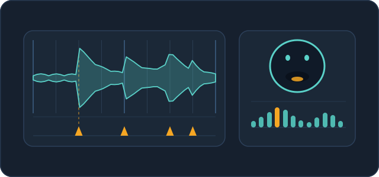

## 分层设计（`audio_design`）

38 个配方按"物体/生物"两大类组织：物体类 26 个（门、玻璃、爆炸、机械、UI、水、脚步……），生物类 12 个（`bird-chirp` `bird-flock` `insect-swarm` `whale-song` `wolf-howl` `frog-croak` `hoofbeats` `wing-flap` `creature-breath` `creature-hiss` `rodent-squeak` `bat-echolocation`）。全部纯合成、零素材，同一个 seed 产出同样的字节。

每个配方"像什么、由哪些层构成、怎么调"，以及"哪些动物纯合成做不到、为什么"，见 [CREATURES.zh.md](CREATURES.zh.md)。

## 时间线编辑器

浏览器里打开 `/dsh-audio/editor`：载入 cue 表、按波形拖动起点、改增益与淡入淡出、按 BPM 吸附、试听，然后复制成 `audio_bind` / `audio_daw` 可直接用的片段。只读工作区内的 `.json` / `.wav`，不接受路径逃逸。细节见 [EDITOR.zh.md](EDITOR.zh.md)。

## 反向：从音频推 cue 表（`audio_cues`）

`audio_bind` 是 cue 表 → 页面播放；`audio_cues` 是反方向：给一条现成音频（wav），返回 `{ cues: [{ at, strength, kind }], durationSeconds, sampleRate, warnings }`，动画照 `at` 排事件（也可以直接当 cue 时间表喂给页面或 `audio_bind` 的 cue 列表）。参数只有四个：`sensitivity`（0..1，默认 0.5；调高保留更弱的冲击，cue 数单调不减）、`minGapSeconds`（默认 0.08；更近的后一个丢弃，所以 flam 只算一次）、`maxCues`（默认 200；超出时保留最强的并给 warning）、`out`（把同一对象写成 JSON，文件字节可复现）。

检测分两级，都在单声道上进行：

- **onset（冲击）**：5 ms hop、10 ms 滑动窗的 RMS 转 dB；当当前电平比最近 15 ms 的最低电平高出至少一个绝对门限（灵敏度 0 → 12 dB，1 → 4 dB，再叠加局部中位数与平均偏差的自适应项）时成为候选。然后要求"半高宽 ≤ 30 ms"——缓慢渐强（pad 起音、淡入）能量同样在涨，但不尖，不算打击。命中后把时间细化到该 hop 内首个超过 20% 峰值的采样，因此 `at` 不受 5 ms hop 量化：测试里等间隔 4 个 click 的误差是 0 ms，噪声突发在 5 ms 内。
- **section（段落边界）**：前后各 1 s 的能量窗相差 ≥ 6–12 dB（随灵敏度），且边界之后 0.5 s 内电平保持稳定——这一条专门排除混响/长衰减尾巴（否则一次撞击会被误报成一串"段落"）。段落与 onset 落在同一个 `minGapSeconds` 内时，cue 标为 `section`，因为持续的电平变化是更大的结构事实。

限制（选型前先看）：

- **只适合打击类或强弱变化明显的素材。** 连续演奏的音符、持续 pad、埋在底噪里的弱冲击会被漏掉；这是电平检测的固有上限，不做音色/调性分析。
- 混响尾巴、多次重叠的冲击可能被重复计数，或者被 `minGapSeconds` 合并成一个；需要更细的拆分时把 `minGapSeconds` 调小（下限 5 ms）。
- 段落边界只说明"响度变了"，不说明配器/和声变了；渐变过渡的边界可能落在过渡中段，而不是你以为的那一拍。
- 第一步是立体声折单声道：硬声像的素材仍然能测到（只损失一侧的电平），但完全反相的一对声道会互相抵消。
- `sensitivity` 调高会同时引入更多噪声；确定性不受影响——同一文件、同一参数永远得到同一结果。

## 剪辑软件互操作

`audio_daw` 除 EDL / Reaper `.rpp` / CSV / Audacity labels 外，还能导出 OpenTimelineIO（`.otio`，Resolve 直接导入）与 FCP7 XML（`.xmeml`，Premiere / Resolve 可导入）；AAF 目前是"容器与对象图真实、类定义表缺失"的结构子集，Pro Tools 还不能打开；OMF 是明确标注的骨架。各格式的字段覆盖、导入路径与限制见 [INTEROP.zh.md](INTEROP.zh.md)。

## 混音声道（`audio_mix`）

`audio_mix` 保留输入的声道，不再一律折成单声道。默认 `channels: 'auto'` 跟随最宽的输入：只要有一条立体声（或多声道）素材，输出就是立体声；全部单声道输入仍输出单声道，且字节与旧实现完全一致（回归测试用固定 sha256 锁定）。4/6/8 声道素材先按 `lib/multichannel.js` 的 WAVE 布局矩阵折叠到 L/R，LFE 不混入左右（`lfeDropped: true`）；单声道素材进立体声时按等功率声像律放在正中（两侧各 −3 dB，与 `audio_convert` 的 `channels: 2` 一致），折叠回单声道可还原电平。限幅与峰值归一化对左右用同一条增益曲线（按每帧最大绝对值驱动、左右统一缩放），因此声像不会漂移。`channels: 1` 强制单声道（旧的平均折叠），`channels: 2` 强制立体声。返回值写明 `channels`（输出声道数）、`foldedFrom`（最宽输入的声道数）与 `inputChannels`（每个输入的实际声道数）。

## 母带（`audio_master`）

`audio_master` 把一条 cue 做到投放响度目标而不削波：LR4 四阶分频多段压缩 → 中侧宽度 + 低音单声道 → 4× 过采样真峰限制器，外层搜索只动增益（一轮 = 1 次限制器应用 + 1 次 LUFS 测量，最多 5 轮）。限制器曲线建在缓存的峰值包络上，迭代不重跑前端压缩/宽度，所以"再试一次"很便宜。目标够不到时写最响的安全电平并报 `shortfallLu`，不写削波文件。目标按 `audio_loudness` 同一口径测量（见下节），所以 mono 文件做到 −23 LUFS 之后，ffmpeg `ebur128` 读到的也是 −23，而不是 −26。

`mode` 只决定搜索怎么花内存，默认 `"memory"`：

| `mode` | 每次迭代保留什么 | 限制器计算次数 | 180 s / 48 kHz 立体声占用 |
| --- | --- | --- | --- |
| `memory`（默认） | 只有标量（增益、LUFS、真峰、trim、GR） | 迭代数 + 1（选中的那次再渲染一遍） | 约 69 MB（一份输出） |
| `fast` | 每次迭代的整段输出样本 | 迭代数（少 1 次重算，约省 10 % 时间） | 约 345 MB = 5 次尝试 × 69 MB |

两种模式的增益、trim 和输出样本逐字节一致（同一输入 SHA-256 相同），`chain.mode` / `chain.modeNote` 说明跑的是哪一种，工具返回值里也有扁平的 `mode` 字段。`fast` 在保留量超过 256 MB 或母带长于 300 s 时，把这条路径的内存代价写进 `chain.warnings`（文本摘要里同样会读出来）——两种模式结果相同，差别只是 RAM。`mode` 传非法值（如 `"turbo"`、大小写不符）直接报错并列出两个合法值，不会静默退回默认。

## 响度测量与校正副本（`audio_loudness`）

**单声道计权。** 按 ITU-R BS.1770-4 的默认口径，一个声道的信号只计权一次（1.0），与 ffmpeg `ebur128`、Youlean 等外部表读到的数字一致：997 Hz 正弦若峰值 −20 dBFS（RMS −23.01 dBFS），读 **−23.01 LUFS**；RMS 为 −20 dBFS 时读 **−20.0 LUFS**（响度是 RMS 量，这点常被"−20 dBFS 应读 −20 LUFS"的直觉混淆）。旧版本把 mono 当 dual-mono（功率 ×2，+3.01 LU），会让同一个文件比 ffmpeg 高 3 LU——`audio_master` 因此对 mono 自称命中 −23 LUFS、文件实测只有 −26。历史口径保留为显式选项：`dualMono: true`（`lib/lufs.js` 的 `analyzeLoudness({ dualMono: true })`、工具参数 `dualMono`）仍按 ×2 计权，便于和旧报告对账；立体声/环绕完全不受这个开关影响，读数逐字节不变。

**多声道校正副本。** 给了 `targetLufs` 与 `out` 时，`audio_loudness` 对 1/2/4/6/8 声道都能写校正副本：一次统一增益（按 `lib/multichannel.js` 的 `loudnessChannels` 口径算 LUFS——LFE 不计入、环绕 +1.5 dB），所以声像与环绕关系不动；真峰值限制到 `ceilingDbtp`（默认 −1 dBTP），并**按写盘后的字节重新测量**，量化把峰值顶上去时用一次线性 trim 补回；保留源文件的声道布局与 16/24 位深（8/32 位源写成 16 位），声道数不变。写盘后回报的是实测值：`written.lufs`、`written.truePeakDbtp`、`written.appliedGainDb`（含 trim）、`written.targetHit`（±0.5 LU 内为命中）与 `written.shortfallLu`。

**安全边界。** `out` 指向输入文件本身时直接报错（同一路径、`./` 变体、Windows 大小写或同 inode 都拒绝），测量工具不会把自己的证据写没。文件里含 NaN/±Infinity 时不再测出 `Infinity dBFS` 或假的"静音"：报 `nonFiniteSamples` 与 `notes`（"非有限采样 N 个"），峰值/响度字段置 `null`，并且拒绝用它写校正副本——算在 NaN 上的电平不是电平。

## 三方对账（`audio_audit`）

旁白 wav、字幕 srt、口型轨是同一根时间轴的三种写法，却分别由 TTS、时间戳转换和口型分析生成，此前没有互相校验：字幕整体偏了 200 ms、删掉一句后其余照旧、字幕压在静音上、停顿里嘴还张着、单帧口型抖动——这些只能靠人眼盯着成片才发现。`audio_audit` 先把音频归约成一张语音图（10 ms 一块，块电平 ≥ 最响块 3 % 记为有声，把 < 60 ms 的停顿合并成一段）；电平取自 `peakEnvelope` 而不是单声道折叠，所以反相立体声不会被误判成静音。三条检查共用同一张图，所以同一个缺陷在不同配对里报出的时间与阈值一致：

- **字幕 ↔ 音频**：每条字幕区间里的实际语音占比（几乎全静音 → error）、没被任何字幕覆盖的语音段（≥ 150 ms 才报）、字幕起点相对它覆盖的第一段语音起点的偏差（超过 `maxDriftMs`（默认 80）报 warn，超过两倍报 error）。每条字幕的带符号偏差与最差项在 `metrics.subtitle.deviations` / `worstDriftMs` 里；报告文字只写"两者相差 X ms"并列出两个时间，不猜晚/早——整体偏移时字幕起点落在下一句语音上，方向词会把人带反。
- **口型 ↔ 音频**：语音时间里口型张开的覆盖率（< 85 % warn，< 50 % error）、静音处张嘴的帧数与时间范围、连续 1 帧换形后立刻换回的抖动处数。静音张嘴按**最长连续段**判断，阈值取 80 ms 与 1.5 帧的较大者：正确轨道在每个语音块收尾处常有一帧 jaw release，低帧率下也不能误报；≥ 300 ms（及两倍释放容差）记 error。轨道声明的 `leadMs` 会按"帧 t 描述的是 t+lead 处的声音"折算，lead 补偿过的轨道不会被判成整体错位。
- **字幕 ↔ 口型**：每条字幕区间内至少要有 1 帧非 `none`；全闭、或根本没有口型帧覆盖该区间，都算 error。这条检查不读音频，所以旁白是静音时照样跑。

只给 `audio` 也能调用，但三条检查都跑不了时 `ok` 是 **false**（摘要写"未对账"）——`ok` 的含义是"已验证"，不能把没执行的检查当成通过；`skipped` 会逐项注明原因（"没提供 srt / visemes"、"srt 里没有字幕条目"或"音频里没有检测到语音"）。工具只读：输入文件永远不改，`out` 若指向 audio/srt/visemes 中任何一个会直接报错而不是覆盖，`out` 只用于把 JSON 报告落盘。

## 批量工程（`audio_batch`）

一次调用处理几十个 wav / 整个 cue 工程。`action` 四选一：`check`（削波 / 静音 / 峰值 / 直流的交付闸，不写盘）、`loudness`（只测 LUFS 与真峰值，汇总区间、最差真峰、静音与偏离目标的文件）、`normalize`（按目标 LUFS 走 `audio_loudness` 同一条增益校正路径，逐文件写副本）、`master`（逐文件跑 `mode:'memory'` 的母带链）。后两者默认 `targetLufs: -14`、真峰上限 −1 dBTP、16-bit 副本，写进 `outDir`（默认 `out/batch`），**永不改写输入**：输出路径若等于任一输入，该文件计一条 `拒绝覆盖输入文件` 错误而不写盘。单个文件读不出来 / 解码失败 / 静音只需一行 `items[].error`，整批继续，`summary.failures` 列出全部失败项；同样的输入两次运行得到同样的 `items` / `summary` 与逐字节相同的副本。

`concurrency`（1..8，默认 CPU 数一半且不超过 4）是 **Promise 池，不是线程池**：底层解码与 DSP 都是同步 JS，并发只让读盘 / 解码 / 写盘的等待重叠，CPU 一次仍只渲染一个文件。报告里 `pool.limit` 是请求的上限，`pool.maxInFlight` 是实测同时在飞的最大值（观测字段，不进 `summary`，因此不影响确定性），`pool.note` 与文本摘要都会写明"CPU 仍是串行"。几十个文件的大批处理建议 `concurrency: 2~4`：每多一份在飞就多一份样本常驻内存。

## 交接简报（`audio_handoff`）

本插件不带音色库、声库和音效素材，也不调用别的插件（DSH 的工具作用域本来就不允许一个插件驱动另一个插件的工具）。`audio_handoff` 把"哪些活该交给谁"落成一份 JSON 合同：只读探测 profile 的 `package.json` 依赖与 `node_modules/<name>/package.json`（不跑进程、不联网、不 import 对方），按 `music` / `narration` / `sfx` 三种角色给出目标插件、能力、逐轨请求与验收回路，再附一段可直接粘贴的中文指令。

- 结果形状：`{ schema: 'dsh-audiokit/handoff@1', prompt, durationSeconds, target, tracks: [{ role, style, capability, owner, ask, boundary, acceptance }], instruction, acceptance, ecosystem }`。`target` 为 `null` 表示没探测到同类插件——简报仍可当分工清单用，装好对方后重跑即可补上目标。
- 能力表是静态的（`instruments` / `soundfonts` / `voicebankSinging` / `ttsProviders` / `dawUi` / `sfxLibrary`），只认表里登记过的插件；不认识的插件只记名字与版本、能力留空，因为猜一个能力等于在合同里写假承诺。
- 确定性：简报里没有时间戳、没有绝对路径。默认输出 `assets/audio/handoff-<内容哈希>.json`，同样的输入与同样的探测结果重复运行写回同一个文件（环境里装了/卸了对方插件，哈希随之变化，这正是"合同变了"）；`out` 以分隔符结尾时写 `<dir>/handoff.json`，没写 `.json` 会自动补上。
- 参数边界：`prompt` 必填且 ≤ 2000 字符，`durationSeconds` 为 1..3600 秒（默认 30），`tracks[].role` 只接受三个角色、`style` 可省。参数校验全在探测与写盘之前完成，坏调用不会留下文件。
- 它只写合同、不执行：对方产出的 wav / midi 回到本插件复检（`audio_probe` / `audio_loudness` / `audio_check`，工程交换用 `audio_daw`）；不复制对方的音源、声库或素材，许可各自独立。

## 交付前验收（`audio_check`）

`audio_check` 原有的三层（技术度量、本地声学自检、可选听感）之外，验收层再补三项判断。三者都只**报告**、从不改写文件，也都不动已有字段；三个块分别由 `lib/verify.js` 的三个纯函数算出，`test/verify.mjs` 用合成信号锁住算术，`test/check.mjs` 锁住工具层接线。

- `compliance` 只在给了 `target` / `loudnessTarget` 时出现，`sync` 只在给了 `cues` 时出现，否则为 `null`。
- `phase` **对所有 ≥2 声道的文件常开**（一次采样遍历，不需要参数）：立体声文件折成单声道会不会坏，和调用者有没有想到要问无关。这是本层唯一会改变旧 verdict 的地方——反相立体声文件以前静默通过，现在记一条 `warn`（不会变 `fail`，`test/check.mjs` 里有专门断言）。

### 平台响度合规（`target` / `loudnessTarget`）

| `target` | 积分响度 | 真峰值上限 | 判定容差 |
| --- | --- | --- | --- |
| `youtube` | -14 LUFS | -1 dBTP | ±1 LU |
| `tiktok` | -14 LUFS | -1 dBTP | ±1 LU |
| `podcast` | -16 LUFS | -1 dBTP | ±1 LU |
| `broadcast` | -23 LUFS（EBU R128） | -1 dBTP | ±1 LU |
| `cinema` | -27 LUFS | -2 dBTP | ±2 LU |

口径和 `audio_loudness` / `audio_master` 一致，但两个量各按各的规矩：**LUFS** 走 `lib/lufs.js` 的 BS.1770-4 门限积分 + `lib/multichannel.js` 的声道决策（LFE 不计入，环绕声道 +1.5 dB；单声道文件只计权一次，与 ffmpeg 一致），所以验收和母带读到的响度不会打架；**真峰值**取整个文件所有声道（含 LFE）的最大值——上限是"编码后的文件"的属性，LFE 冲出上限就是冲出上限，`lib/master.js` 的限幅器 ceiling 也是这么验的。3/5/7 声道这种本插件不会写出、也没有 WAVE 布局可依的文件，退化为所有声道等权测量，仍然给出一个报告而不是拒绝判定。影院刻意不是 -23：影院按固定参考电平重放，交付要更安静，并留 2 dB 峰值余量。

- `|实测 - 目标| ≤ 容差` 判合规；超出记 `warn`，超过 3 倍容差记 `error`（这是投错文件的量级）。真峰值高于上限直接 `error`：有损编码会在采样点之间过冲，真峰值才是编码后真正保留下来的峰值。
- 报告给 `lufsDelta`（带符号，正 = 比平台目标响）、`peakOverDbtp` / `peakHeadroomDbtp` 和 `suggestedGainDb` 建议增益——**只是建议，不改文件**。要真归一化，交给 `audio_master` 或 `audio_loudness`。
- 静音文件报 `measured.silent: true`、积分响度取 -70 LUFS 门限、不给增益建议：从门限推出来的 "+56 dB" 是编出来的答案。
- 判定不了的文件（样本率低于 BS.1770 计量的 8 kHz 下限等）记一条 `warn` 说明原因，`compliance.files` 里不会出现它，摘要写"没有可判定的文件"——绝不把没测过的文件算成合规。
- 表里没有的平台用 `loudnessTarget: { targetLufs, ceilingDbtp, toleranceLu, label }` 自定义；`target` 和 `loudnessTarget` 只能给一个。
- `paths` 里的文件和 cue 指向的源文件都会逐个判定（`compliance.files[]`），所以 `audio_check({ cues, target })` 也能验收一组素材。

### 相位与单声道兼容（`phase`）

每个 ≥2 声道的文件一条报告，只判定前两个声道（立体声 `L/R`、环绕 `FL/FR`）：其余声道在单声道折叠时只会相加，不会互相抵消，判定它们没有意义。

- `correlation`：整段文件的左右声道 Pearson 相关性，+1 完全相同、-1 完全反相、0 左右无关；某一侧没有能量时为 `null`。`< -0.5` 判 `antiphase` 并记 `warn`：立体声还能听，单声道设备会丢内容。
- `monoLossDb`：单声道折叠的峰值损失。参考量刻意取**未缩放的 L+R**，不是 0.5 平均折叠——0.5 平均会让硬声像（只有左或只有右）白丢 6 dB 声像律，于是 "> 6 dB" 的报警会误报在任何偏声像的素材上；对 L+R 取比，硬声像读 0 dB，报警就真的等于"有内容在相位上抵消"。损失按峰值比算，恰好抵消成 0 时读满 120 dB 上限（改成两个 -120 dBFS 下限值相减会得到自相矛盾的 0 dB）；16-bit 文件里两声道共享的抖动噪声不会抵消，实测约 78 dB 而不是无穷大。
- `monoFoldPeakDbfs` 是信息量：真正导出的单声道会得到的峰值（布局下混、LFE 丢弃）。
- 只有 `warn` 没有 `error`：反相是投放风险，不是文件损坏。

### cue 与画面同步（`sync`）

- 目标时间两种写法：`cues[].expectAt`，或与 `cues` 一一对应的 `targets` 数组；两者都给时逐条 `expectAt` 优先。每个 cue 报带符号偏差 `at - expectAt`（正 = 晚），并汇总 `maxDeviationSeconds` 与 `worstIndex`。
- 默认容差 0.05 s（20 fps 一帧，也是"晚拍"开始听得出来的量级，声音提前远没有这么敏感）；超出容差记 `warn`，超过 `max(4×容差, 0.2 s)` 记 `error`——偏到那个量级就是听得出的事故。容差可用 `toleranceSeconds` 调整。
- 没给目标时间时只做时间轴一致性检查：cue 是否按时间升序、同一秒是否重复排了同一个文件（会叠成两倍电平）。**重叠不报**——分层音效本来就重叠；也不会搬动任何 cue。
- `targets` 长度与 `cues` 不一致（含显式的空数组：给了 `targets` 就是要每条都有目标）、`expectAt` 或 `targets` 里不是合法时间（负数、字符串、NaN）都在读取文件之前直接报错，避免整张表的偏差错位一格。

### 验收怎么跑

```bash
node test/verify.mjs   # 三块纯函数的算术：合规/不合规、反相、单声道损失、cue 偏差
node test/check.mjs    # 工具层：旧返回形状不变 + compliance / phase / sync 接线
```


